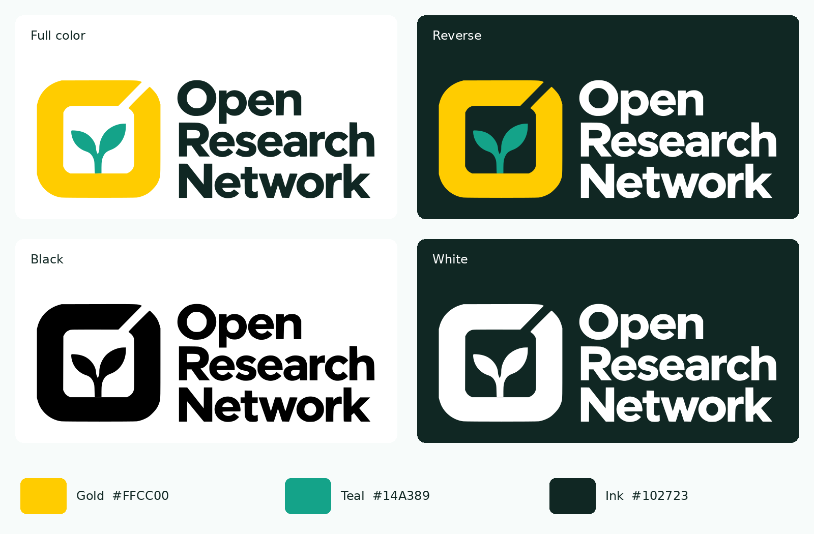

# Open Research Network logo kit

The approved identity is an open gold O containing a green-teal sprout, with
**Open / Research / Network** in three lines beside it. This kit uses the
website palette and retains the approved letterforms as editable vector paths.
No fonts, linked images, or external resources are needed to display the logos.



## Choose a layout

| File prefix | Layout | Typical use |
| --- | --- | --- |
| `logo` | Symbol at left; three-line name at right | Primary identity, website header, documents |
| `logo-stacked` | Symbol above the three-line name | Narrow or portrait compositions |
| `symbol` | Open O and sprout only, square canvas | Favicon, social avatar, app icon |
| `wordmark` | Three-line name only | Supporting use where the symbol already appears |

Every layout has four color treatments:

| Suffix | Treatment | Background |
| --- | --- | --- |
| No suffix | Gold O, green-teal sprout, dark green name | White or very light |
| `-reverse` | Gold O, green-teal sprout, white name | Dark, uncluttered |
| `-black` | Entire mark in pure black | Light; single-ink production |
| `-white` | Entire mark in white | Dark; reversed single-ink production |

Reverse and white files have transparent backgrounds. Their white elements
may be invisible in a preview application with a white canvas.

## Formats and folders

- **SVG:** resolution-independent, transparent, outlined artwork. Use on the
  website and edit in Illustrator, Inkscape, Affinity Designer, or Figma.
- **`source/logo-master.svg`:** canonical editable path master. Update it first
  when changing the actual design, then regenerate the exports.
- **`png/`:** transparent sRGB PNGs at 1024 and 2048 pixels wide for every
  layout and treatment. `logo.png` is the 1024-pixel primary compatibility copy.
- **`print/*.pdf` (no `-cmyk` suffix):** vector PDFs preserving the digital RGB
  palette for presentations, general document use, and printer-managed conversion.
- **`print/*-cmyk.pdf`:** vector PDFs with explicit DeviceCMYK process fills,
  for full-color and black versions of each layout. Black uses only K.
- **`print/*.eps`:** legacy vector EPS versions in RGB, for full-color and
  black artwork. Use PDF when the production workflow supports it.
- **`social-card.png`:** 1200 x 630 image with a light background for link previews.
- **`brand-overview.png`:** visual reference showing the four primary treatments.
- **`palette.json`:** machine-readable digital palette.
- **`../../icons/`:** SVG favicon, multi-size ICO, 16/32/48-pixel PNG favicons,
  180-pixel Apple icon, 192/256/512-pixel launcher icons, and a Windows tile.

The PDFs use a nominal RGB-to-CMYK process conversion, not a press-specific ICC
profile or certified PDF/X preset. For color-critical print, have the printer
apply the profile for the chosen press and paper. Digital HEX colors are the
reference; do not treat the process conversion as a Pantone specification.

## Palette

Colors match `--orn-gold`, `--orn-teal-2`, and `--orn-heading` in
`theme/css/index.css`.

| Role | HEX | RGB | Nominal CMYK (%) |
| --- | --- | --- | --- |
| Gold O | `#FFCC00` | 255, 204, 0 | 0, 20, 100, 0 |
| Green-teal sprout | `#14A389` | 20, 163, 137 | 88, 0, 16, 36 |
| Dark green name | `#102723` | 16, 39, 35 | 59, 0, 10, 85 |

## Use and spacing

- Prefer the primary full-color logo on white. Use reverse artwork on the
  site's dark green surfaces. Use the symbol where a full name is too small.
- Leave at least half the thickness of the O's gold stroke clear around the
  visible artwork; more space is encouraged. SVG canvas padding is not the
  complete clear-space allowance.
- Recommended minimum: 160 CSS pixels wide for the primary lockup and
  24 pixels wide for the symbol. The dedicated favicon is the small-size exception.
- Preserve the aspect ratio, diagonal opening, sprout, and lettering. Do not
  stretch, recolor individual letters, add effects, or place over busy imagery.
- The sprout stays green-teal; gold is the O's fill, not a background panel.

## Rebuild exports

From the repository root, in a Python environment with system Cairo:

```sh
python -m pip install CairoSVG==2.9.1 Pillow==13.0.0 pypdf fonttools
python tools/export_logos.py
```

The generator reads the outlined master and recreates all supplied layouts,
color variants, raster and print exports, social image, and icon files. It is
an optional design-production tool; it is not required for the MkDocs build.

The older `logo-idea.png`, `logo-discord.png`, and `logo.xcf` are historical
assets retained from the repository. They are not current logo masters.
